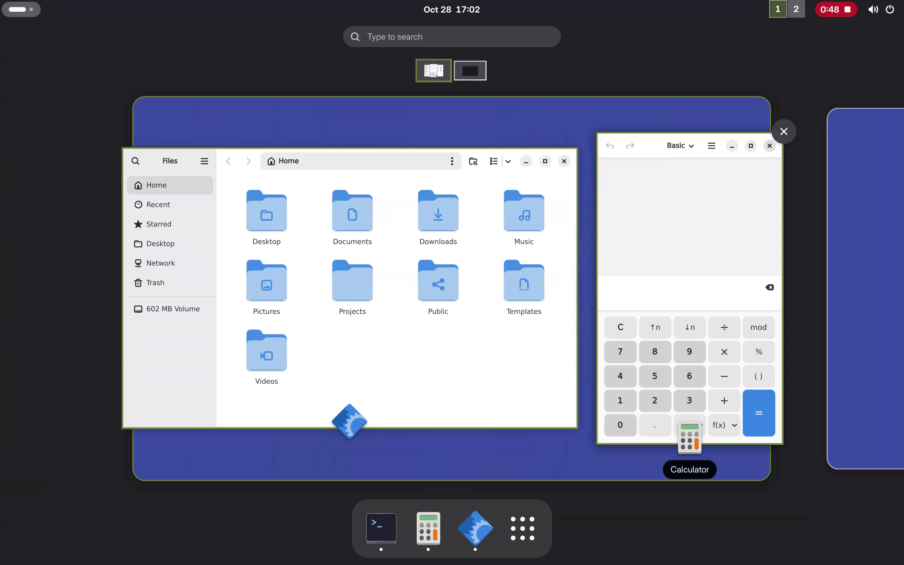

  <picture>
    <source media="(prefers-color-scheme: dark)" srcset="docs/assets/airlock-wordmark-thin-red-dark.svg">
    
  </picture>

AirlockOS uses the [Qubes](https://www.qubes-os.org/) architecture, with
[machine configuration written in Rust](https://airlockos.org/docs/architecture/configuration-and-generations/)
and built through Nix. Xen runs all virtual
machines (VMs), including dom0, the privileged control VM.

**[Website](https://airlockos.org/) · [Documentation](https://airlockos.org/docs/) · [Getting started](https://airlockos.org/docs/getting-started/)**

- [NixOS](https://nixos.org/) for dom0, the desktop, networking, and user applications.
- [Whole-machine updates](https://airlockos.org/docs/architecture/system-changes-and-approval/)
  and [system generation rollback](https://airlockos.org/docs/using-airlock-os/#whole-machine-rollback).
- [Shared global Nix store](https://airlockos.org/docs/architecture/storage/) with read-only per-VM closure views.
- [Persistent private VM data](https://airlockos.org/docs/architecture/storage/#private-data) across updates and rollback.
- [Qubes VM isolation, device assignment, and inter-VM RPC policy](https://airlockos.org/docs/architecture/).
- [GNOME desktop displaying applications from multiple VMs](https://airlockos.org/docs/architecture/gui-and-input/).

  
   
  <em>AirlockOS desktop and VM workspaces. <a href="https://youtu.be/h528TDh-PLU">Watch the video.</a></em>

AirlockOS is under active development. Qubes OS security equivalence has not
been established. See [Security](SECURITY.md) for limitations and reporting.

Original code is [MIT licensed](LICENSE). Dependencies retain their own terms.
